# Sweety – Blood Glucose Tracker

Sweety is a full-stack blood glucose tracking application that helps users record their daily glucose readings, manage their reading history, and monitor glucose levels through daily and monthly reports.

The application supports individual user accounts, secure authentication, input validation, and user-specific data access.

## Features

### Authentication
- User registration and login.
- Password hashing using bcrypt.
- JWT-based authentication.
- Protected application routes.
- User-specific data access.

### Blood Glucose Readings
- Create, view, update, and delete glucose readings.
- Four daily reading slots:
  - Morning
  - After Breakfast
  - After Lunch
  - After Dinner
- Reading values restricted to 40–600 mg/dL.
- Maximum one reading per slot per day.
- Future-dated readings are not allowed.
- Paginated reading history.

### Reports
- Daily glucose summary.
- Month-to-date summary, covering the first day of the selected month through the selected date.
- Previous full calendar month summary.
- Average, minimum, maximum, and total reading count.
- Daily breakdown by reading slot.
- Monthly glucose trend chart with daily averages.

### Additional Features
- Responsive React interface.
- Form validation and error handling.
- PostgreSQL database with relational constraints.
- Repeatable demo-data seed script.
- Automated frontend and backend tests.
- Docker Compose deployment for the database, API, and frontend.


## Screenshots

### Authentication

| Sign In | Sign Up |
|---|---|
| 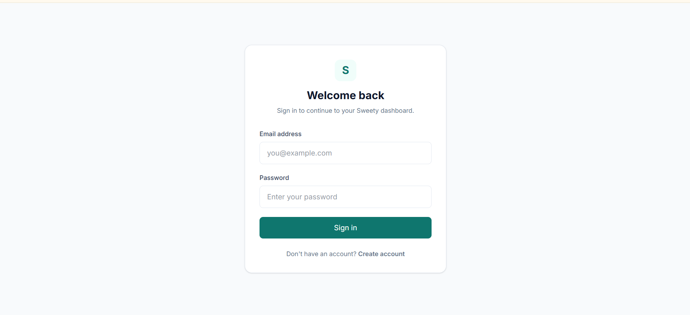 | 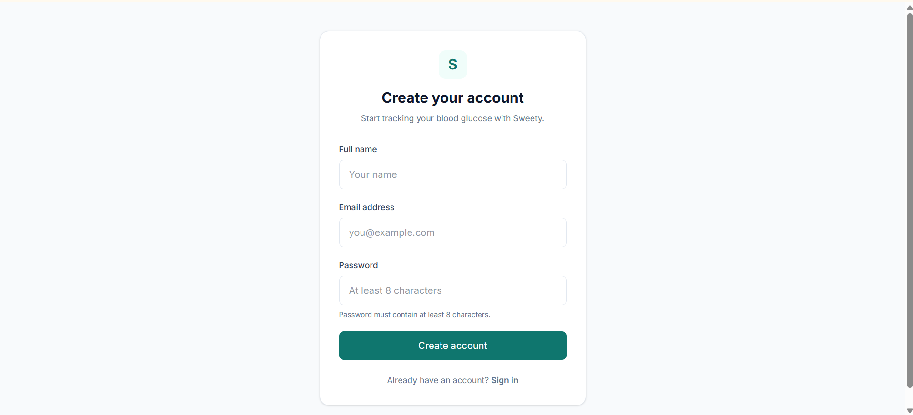 |

### Dashboard

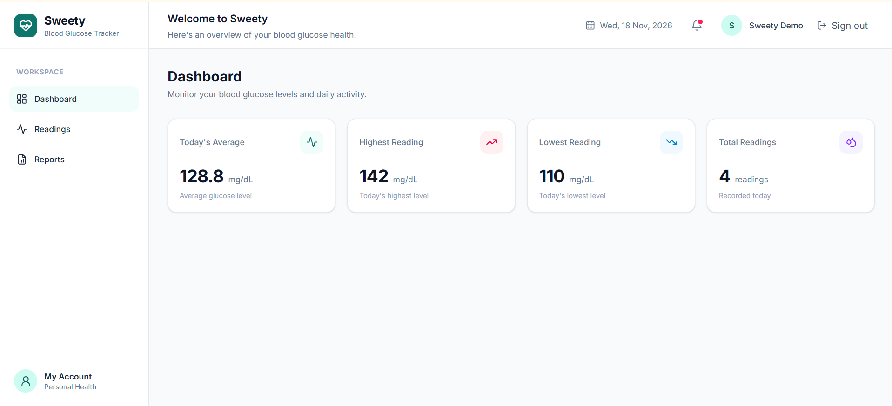

### Blood Glucose Readings

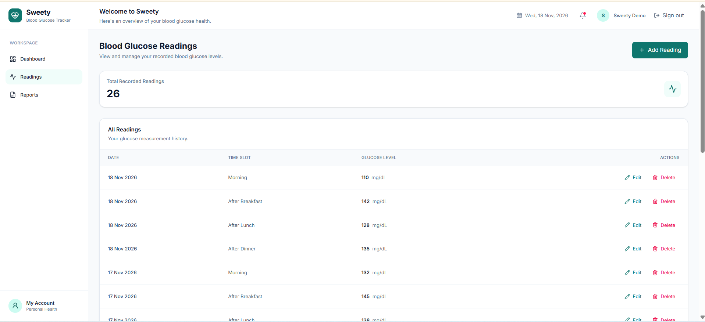

| Add Reading | Select Reading Date |
|---|---|
| 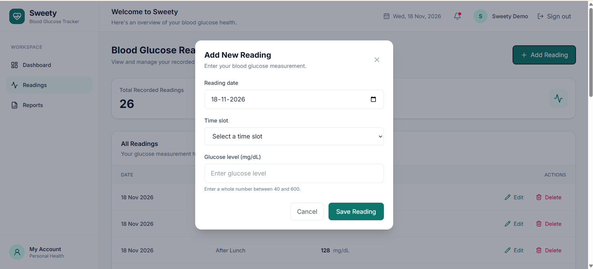 | 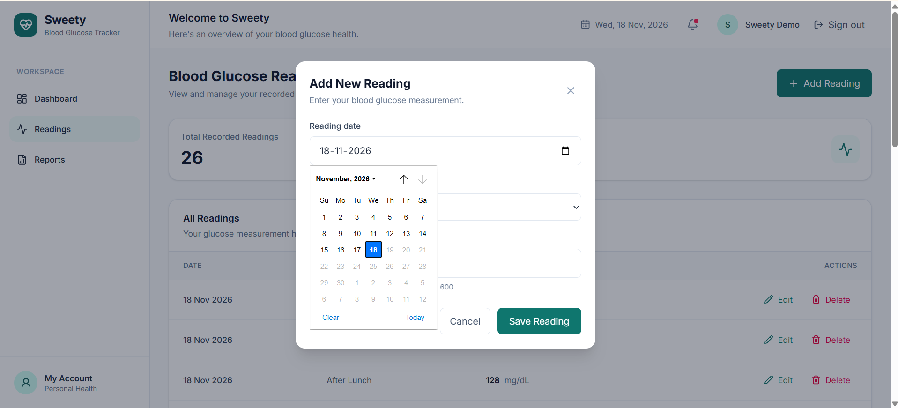 |

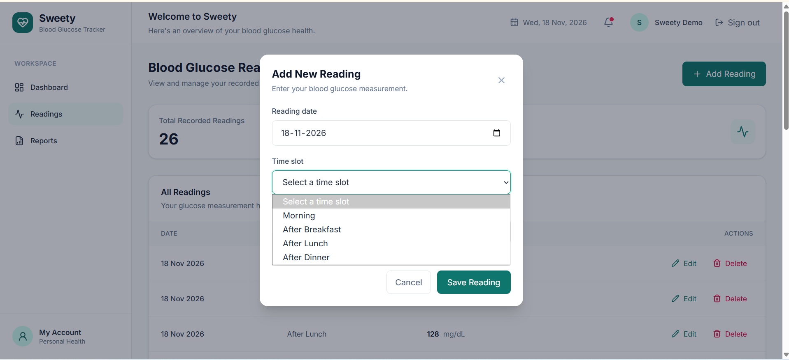

### Reports

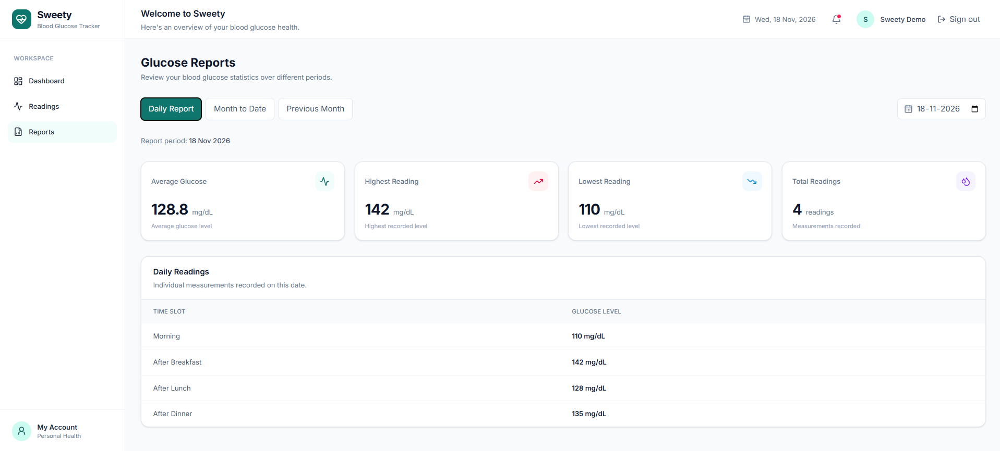

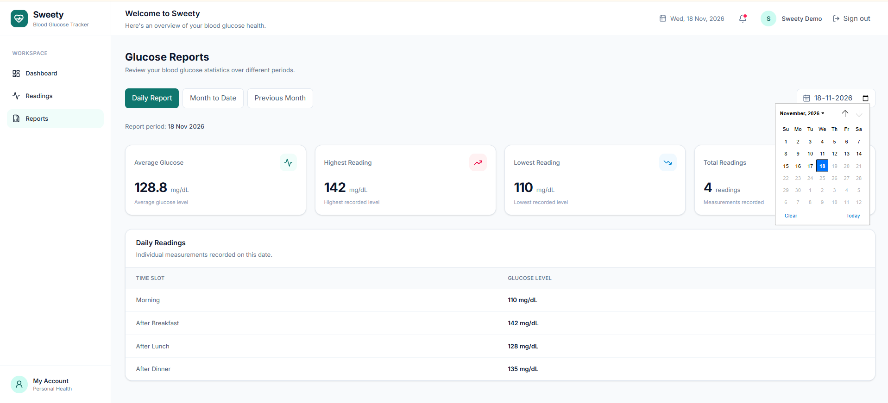

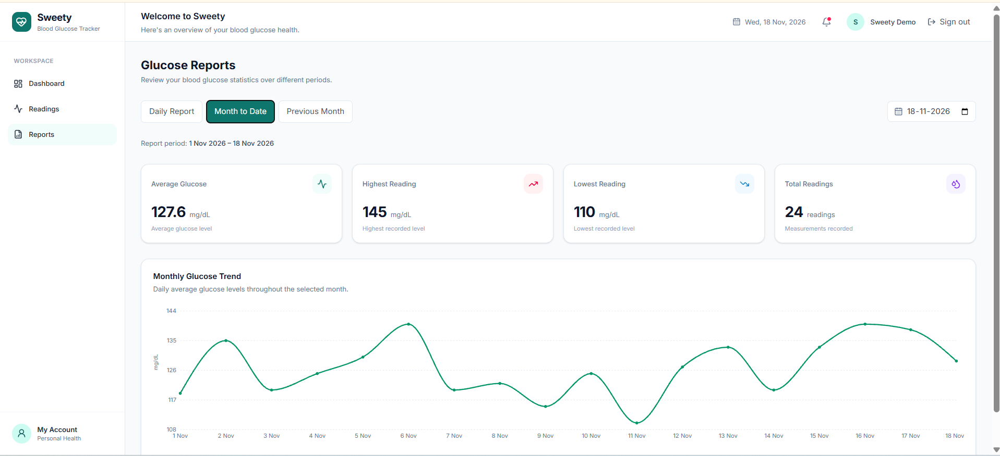

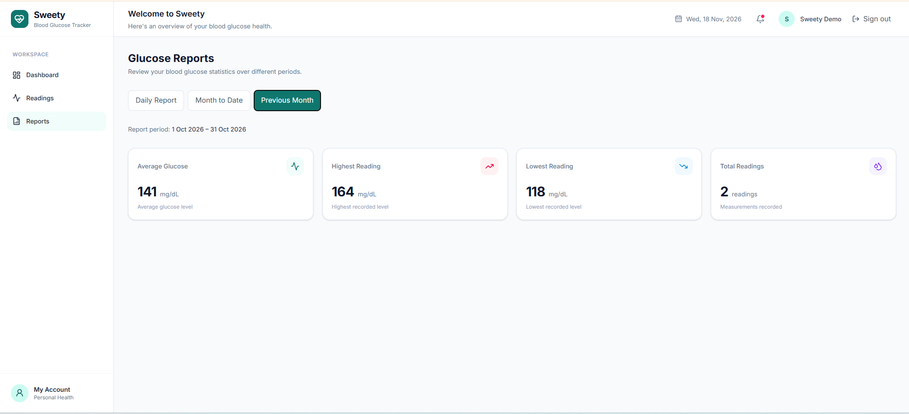


## Tech Stack

| Layer | Technologies |
|---|---|
| Frontend | React 19, Vite 8 |
| Styling | Tailwind CSS 4 |
| Backend | Node.js, Express 5 |
| Database | PostgreSQL 17 |
| Authentication | JWT |
| Password Hashing | bcrypt |
| Validation | Zod |
| API Client | Axios |
| Routing | React Router |
| Charts | Recharts |
| Testing | Vitest, Supertest, React Testing Library |
| Containerization | Docker, Docker Compose, Nginx |
| Package Manager | pnpm |

## Project Structure

```text
sweety/
├── apps/
│   ├── api/
│   │   ├── src/
│   │   │   ├── config/
│   │   │   ├── middleware/
│   │   │   ├── modules/
│   │   │   │   ├── auth/
│   │   │   │   ├── readings/
│   │   │   │   └── reports/
│   │   │   ├── scripts/
│   │   │   ├── app.js
│   │   │   └── server.js
│   │   └── package.json
│   └── web/
│       ├── src/
│       │   ├── components/
│       │   ├── features/
│       │   ├── lib/
│       │   ├── pages/
│       │   └── App.jsx
│       └── package.json
├── database/
│   └── migrations/
│       └── 001_create_initial_schema.sql
├── docker/
│   ├── api/
│   │   └── Dockerfile
│   └── web/
│       ├── Dockerfile
│       └── nginx.conf
├── docs/
├── docker-compose.yml
├── .dockerignore
├── .env.example
├── package.json
├── pnpm-workspace.yaml
└── README.md
```

## Prerequisites

Install the following before running the application:

- Node.js 22 or later.
- pnpm 11.
- Docker Desktop with Docker Compose.
- Git.

## Getting Started – Local Development

### 1. Clone the repository

```bash
git clone https://github.com/harshalyuvraj/sweety-blood-glucose-tracker.git
cd sweety-blood-glucose-tracker
```

### 2. Install dependencies

```bash
pnpm install
```

### 3. Configure environment variables

Create a local environment file:

```bash
cp .env.example .env
```

Update `.env` with your database password and a secure JWT secret.

```env
PORT=5000
NODE_ENV=development
CLIENT_URL=http://localhost:5173

DB_HOST=localhost
DB_PORT=5432
DB_NAME=sweety
DB_USER=sweety_user
DB_PASSWORD=your_database_password

JWT_SECRET=your_secure_jwt_secret
JWT_EXPIRES_IN=1d

SEED_DEMO_NAME=Sweety Demo
SEED_DEMO_EMAIL=demo@sweety.app
SEED_DEMO_PASSWORD=your_demo_password
```

Use a strong, randomly generated JWT secret and demo password. Never commit your actual `.env` file.

### 4. Start PostgreSQL

```bash
docker compose up -d postgres
```

Verify that the database container is running:

```bash
docker compose ps
```

> **Note:** The current Docker Compose configuration uses a WSL-specific host directory for PostgreSQL persistence. If you are running the project in another environment, update the PostgreSQL volume mapping in `docker-compose.yml` to a suitable local directory or Docker named volume.

### 5. Apply database migrations

Run the initial schema migration:

```bash
docker exec -i sweety-postgres psql -U sweety_user -d sweety < database/migrations/001_create_initial_schema.sql
```

This creates the users and readings tables, along with their constraints and indexes.

### 6. Seed demo data

```bash
pnpm --filter @sweety/api seed
```

The seed script creates a demo account and inserts sample readings covering the previous month and current month.

The script is safe to run repeatedly: existing demo-account data and readings are preserved.

### 7. Start the backend

Open a terminal:

```bash
pnpm dev:api
```

The API will be available at:

`http://localhost:5000`

### 8. Start the frontend

Open another terminal:

```bash
pnpm dev:web
```

The frontend will be available at:

`http://localhost:5173`

## Running with Docker Compose

Docker Compose can run the complete application using the API and frontend production images.

### 1. Configure environment variables

Make sure the root `.env` file exists and contains valid values for:

- `DB_PASSWORD`
- `JWT_SECRET`
- `JWT_EXPIRES_IN`
- `SEED_DEMO_NAME`
- `SEED_DEMO_EMAIL`
- `SEED_DEMO_PASSWORD`

### 2. Start PostgreSQL

```bash
docker compose up -d postgres
```

### 3. Apply the database migration

For a new database, apply the schema before starting the API:

```bash
docker exec -i sweety-postgres psql -U sweety_user -d sweety < database/migrations/001_create_initial_schema.sql
```

If the schema has already been applied, do not apply the initial migration again.


### 4. Build and start the complete application

```bash
docker compose up -d --build
```

Wait until the PostgreSQL and API containers report healthy and the frontend container is running:

```bash
docker compose ps
```


### 5. Seed demo data

After the API container is running and healthy, execute:

```bash
docker compose exec api node src/scripts/seed.js
```

This creates the demo account and sample readings using the seed configuration in `.env`.


### 6. Access the application

| Service | Address |
|---|---|
| Frontend | `http://localhost:8080` |
| API | Internal Docker network, port 5000 |
| PostgreSQL | `localhost:5432` |

Nginx serves the frontend and forwards `/api` requests to the backend API.

To view application logs:

```bash
docker compose logs -f
```

To stop the application:

```bash
docker compose down
```

This command stops and removes the containers but preserves the PostgreSQL data directory.

> **Note:** The current PostgreSQL volume mapping uses `/home/harsh/docker-data/sweety/postgres` and is configured for the development environment used for this project. Update it when deploying in another environment.

## API Endpoints

All endpoints return JSON responses.

### Authentication

| Method | Endpoint | Description | Authentication |
|---|---|---|---|
| POST | `/api/auth/register` | Register a new user | No |
| POST | `/api/auth/login` | Log in | No |

### Blood Glucose Readings

| Method | Endpoint | Description |
|---|---|---|
| POST | `/api/readings` | Create a reading |
| GET | `/api/readings` | Get paginated readings |
| GET | `/api/readings/:id` | Get a reading by ID |
| PUT | `/api/readings/:id` | Update a reading |
| DELETE | `/api/readings/:id` | Delete a reading |

All reading endpoints require authentication.

The readings endpoint supports pagination using `page` and `limit` query parameters.

Example:

```text
GET /api/readings?page=1&limit=20
```

### Reports

| Method | Endpoint | Description |
|---|---|---|
| GET | `/api/reports/daily` | Get daily report |
| GET | `/api/reports/month-to-date` | Get month-to-date report and daily trends |
| GET | `/api/reports/previous-month` | Get previous full month report |

All report endpoints require authentication.

The daily report accepts an optional `date` query parameter in `YYYY-MM-DD` format.

The month-to-date report supports a selected date, and the previous-month report covers the complete preceding calendar month.

### Health Check

| Method | Endpoint | Description |
|---|---|---|
| GET | `/api/health` | Check API and database health |

## Testing

Run all project tests from the repository root:

```bash
pnpm test
```

Run backend tests independently:

```bash
pnpm --filter @sweety/api test
```

Run frontend tests independently:

```bash
pnpm --filter @sweety/web test
```

Build the frontend:

```bash
pnpm --filter @sweety/web build
```

Build all workspaces:

```bash
pnpm build
```

The test suites cover backend API behavior, validation, authentication, frontend components, reading management, reports, and monthly trend chart behavior.

## Demo Account

A demo account is created by the seed script.

| Field | Value |
|---|---|
| Email | `demo@sweety.app` |
| Password | The value configured in `SEED_DEMO_PASSWORD` in your local `.env` |

For security, demo credentials should be configured locally and should not contain private production credentials.

## Security and Data Integrity

- Passwords are hashed using bcrypt before storage.
- Protected endpoints require a valid JWT.
- Reading queries are scoped to the authenticated user.
- Database constraints prevent duplicate readings for the same user, date, and slot.
- Input validation is performed using Zod.
- Database queries use parameterized statements.
- User deletion cascades to associated readings.
- Environment secrets are excluded from version control.

## Notes and Assumptions

- Glucose readings are recorded in mg/dL.
- Valid reading values are restricted to the range 40–600 mg/dL.
- Each user can record at most one reading for each of the four daily slots on a given date.
- A reading date cannot be in the future.
- Month-to-date reports cover the first day of the selected month through the selected date.
- Previous-month reports cover the entire preceding calendar month.
- Reading history and reports are isolated by authenticated user.
- The demo account and its sample readings are provided through the seed script.

## Future Improvements

Given more development time, the application could be extended with:

- Redis-based caching for frequently requested reports.
- Background processing for scheduled reports and notifications.
- More advanced analytics, including configurable glucose ranges and historical comparisons.
- Additional automated end-to-end tests.
- More granular roles and access control for healthcare professionals.
- Production deployment with managed PostgreSQL, HTTPS, monitoring, and automated backups.

## License

No open-source license has been specified for this project.